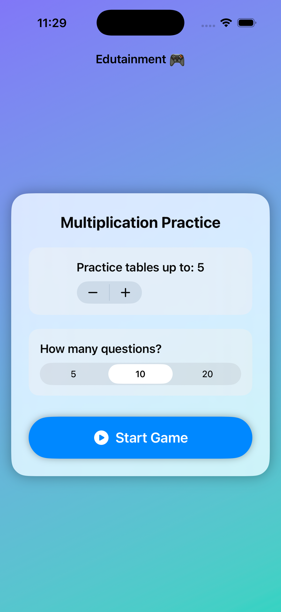
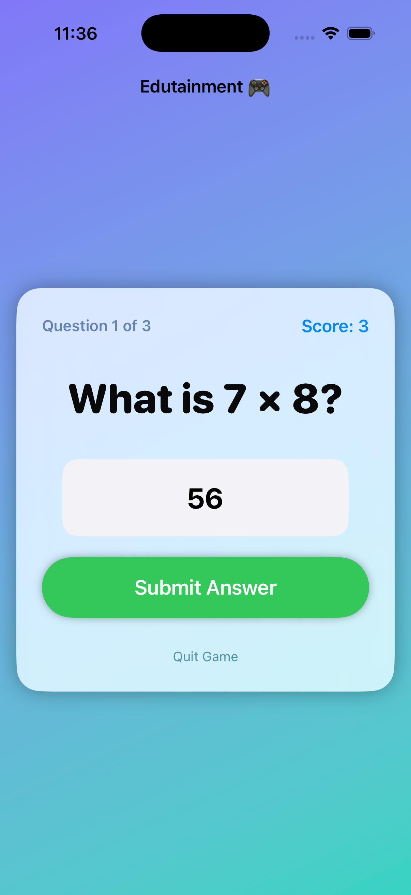
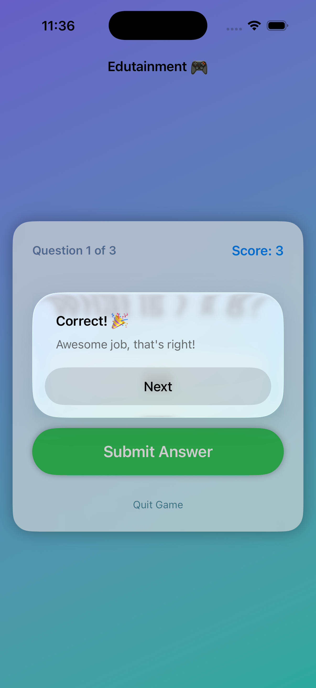

# Edutainment 🎮

A fun, interactive multiplication practice app designed for kids, built natively for iOS using **SwiftUI**. 

Developed as the **Milestone Project for Days 31–35 (Projects 4–6)** in Paul Hudson's [100 Days of SwiftUI](https://www.hackingwithswift.com/100/swiftui).

---

## 📱 Preview

<p align="center">
  
  &nbsp;&nbsp;
  
  &nbsp;&nbsp;
  
</p>
<p align="center">
  <em>1. Practice Configuration &nbsp;&bull;&nbsp; 2. Live Question & Input &nbsp;&bull;&nbsp; 3. Real-time Feedback</em>
</p>

---

## 📸 Overview

**Edutainment** combines education with entertainment to make memorizing times tables engaging and enjoyable for kids:

1. **Practice Table Selection**: Choose which multiplication table to practice (from 2 up to 12) using a stepper.
2. **Question Count Options**: Choose game length with 5, 10, or 20 questions using a segmented picker.
3. **Randomized Questions**: Generates randomized multiplication questions from the selected table pool.
4. **Kid-Friendly UI**: Soft glassmorphism cards with `.regularMaterial`, responsive animations, and a colorful background gradient.
5. **Score & Feedback**: Immediate feedback after each question, tracking total score and showing a victory alert upon finishing.

---

## 🚀 Features

- 🧮 **Custom Table Selection**: Adjust tables from 2 to 12 via `Stepper`.
- 🔢 **Segmented Picker**: Select between 5, 10, and 20 question sets.
- 📱 **Number Pad Input**: Smooth number pad keyboard for distraction-free numeric entry.
- 🎯 **Real-time Feedback**: Instant alerts informing whether an answer is correct, or revealing the correct answer.
- 🏆 **Game Over & Restart**: Displays final score summary and allows instant replay.
- ✨ **Fluid SwiftUI Transitions**: Smooth spring animations between settings and gameplay.

---

## 🛠️ Tech Stack & Concepts

- **Language:** Swift 5.9+ / Swift 6
- **Framework:** SwiftUI
- **Minimum iOS Target:** iOS 17.0+
- **Concepts Consolidated:**
  - `@State` properties for reactive UI and game state management.
  - Input controls: `Stepper`, `Picker`, `TextField`, `Button`.
  - View layout: `VStack`, `HStack`, `ZStack`, `LinearGradient`, and `.regularMaterial`.
  - Alerts: `.alert` for per-question feedback and game completion dialogs.
  - Animations: `withAnimation(.spring)` for view transitions.

---

## 📦 How to Run

1. Clone the repository:
   ```bash
   git clone git@github.com:selva7378/Edutainment.git
   cd Edutainment
   ```
2. Open `Edutainment.xcodeproj` in **Xcode 15+** or **Xcode 16+**.
3. Select an iOS Simulator (e.g. iPhone 16 / 17 Pro) or your physical device.
4. Press `Cmd + R` to build and run.

---

## 👤 Author

**Selva Ganesh**
- GitHub: [@selva7378](https://github.com/selva7378)
